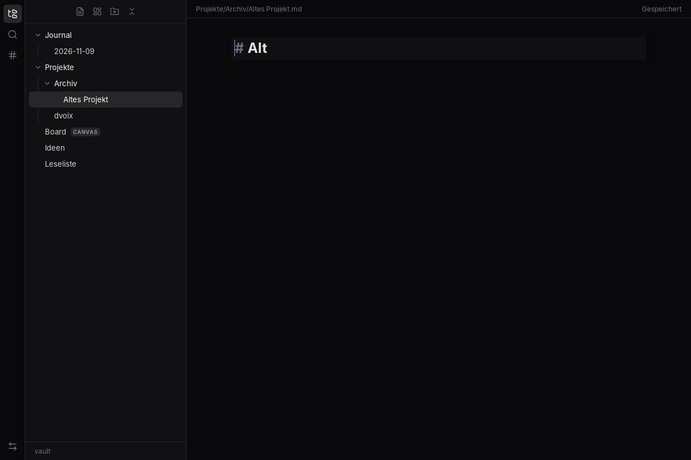

# dvoix

Eine Desktop-App für Notizen, Projektmanagement, Tracking und alles, was später dazukommt. Wie bei Obsidian liegen alle Daten als ganz normale Dateien in einem Ordner auf deinem PC (dem **Vault**). Die Dateien sind die einzige Quelle der Wahrheit; alles andere ist ein Cache, der jederzeit neu aufgebaut werden kann.



## Was schon geht

- Vault-Ordner wählen, der zuletzt geöffnete wird beim Start wieder geladen
- Seitenleiste wie in Obsidian: schmale Icon-Leiste ganz links (Dateien, Suche, Tags), daneben das Panel, in der Breite ziehbar und per Klick aufs aktive Icon einklappbar
- Datei-Explorer mit Ordnerbaum: Ordner auf- und zuklappen (wird gemerkt), Rechtsklick-Menü zum Anlegen, Umbenennen und Löschen (landet in `.trash/` im Vault), Dateien per Drag & Drop in Ordner verschieben
- Markdown-Editor (CodeMirror 6) mit YAML-Frontmatter, `[[Wikilinks]]` (Strg/Cmd + Klick öffnet oder legt die Notiz an) und `#tags`
- Automatisches Speichern, atomar geschrieben (erst Temp-Datei, dann umbenennen)
- Änderungen von außen (VS Code, Sync-Tools, git) erscheinen sofort in der App
- Volltextsuche, Tag-Übersicht und Backlinks („Verlinkt von“)
- Erster eigener Dateityp: `.canvas` im offenen [JSON-Canvas-Format](https://jsoncanvas.org) (Karten verschieben, Doppelklick legt eine Karte an)

## Tech-Stack

| Schicht | Technik |
| --- | --- |
| App-Hülle | [Tauri 2](https://v2.tauri.app) |
| Kern (Rust) | `notify` (Dateiwächter), `pulldown-cmark` + `serde_yaml_ng` (Markdown & Frontmatter), `rusqlite` mit FTS5 (Index & Suche) |
| Frontend | Svelte 5, TypeScript, Vite, Tailwind CSS 4 |
| Editor | CodeMirror 6 |

## Aufbau

```
crates/dvoix-core/      Rust-Kern ohne Tauri, eigenständig testbar
  src/vault.rs          Lesen/Schreiben im Vault, Pfade immer relativ und abgesichert
  src/markdown.rs       Frontmatter, Titel, Tags, Links, Überschriften, Suchtext
  src/index.rs          SQLite-Index in <vault>/.dvoix/index.sqlite (nur Cache)
  src/watcher.rs        meldet Änderungen auf der Platte
src-tauri/              Tauri-App: hält den offenen Vault, verbindet Watcher, Index und UI
  src/commands.rs       alle Befehle, die das Frontend aufrufen kann
src/                    Svelte-Frontend
  lib/api.ts            typisierte Aufrufe der Rust-Befehle
  lib/vault.svelte.ts   App-Zustand: offener Vault, offene Datei, Speichern
  lib/filetypes/        Dateityp-Registry, je Typ ein Ordner (markdown, canvas, ...)
  lib/ui.svelte.ts      Layout-Zustand: aktives Panel, Breite, aufgeklappte Ordner
  lib/components/       Ribbon, Seitenpanel, Datei-Explorer, Suche, Tags, Dateiansicht
```

Im Vault legt dvoix nur den versteckten Ordner `.dvoix/` an (Index, später Einstellungen). Den kannst du jederzeit löschen. Ordner, die mit `.` beginnen, werden nicht angezeigt und nicht indexiert.

## Einen neuen Dateityp hinzufügen

Jedes Feature ist ein eigenes Modul aus Dateiendung und Ansicht. Beispiel Kanban-Board als `.board`:

1. Ordner `src/lib/filetypes/board/` anlegen mit einer `BoardView.svelte`. Sie bekommt `content` (Dateiinhalt als Text) und ruft `onchange(neuerInhalt)` auf, wenn sich etwas ändert. Speichern übernimmt die App.
2. Daneben `index.ts`:
   ```ts
   export const boardType: FileType = {
     id: "board",
     label: "Board",
     extensions: ["board"],
     icon: Kanban, // beliebiges Icon aus @lucide/svelte
     view: BoardView,
     template: () => JSON.stringify({ columns: [] }, null, 2),
   };
   ```
3. In `src/lib/filetypes/index.ts` mit `registerFileType(boardType)` eintragen.

Damit erscheint „Board erstellen“ in der Werkzeugleiste und im Rechtsklick-Menü des Explorers und `.board`-Dateien öffnen sich in der neuen Ansicht. Soll der Typ auch durchsuchbar sein, bekommt `crates/dvoix-core/src/index.rs` eine Extraktion für die Endung (siehe `is_indexable`).

Für Projekte und Tracking ist Frontmatter der Baustein: `status: active`, `due: 2026-12-01` usw. landen im Index und lassen sich mit `notes_where("status", "active")` abfragen.

## Entwickeln

Voraussetzungen: [Rust](https://rustup.rs), Node.js 22 und die [Tauri-Systemabhängigkeiten](https://v2.tauri.app/start/prerequisites/) für dein Betriebssystem.

```sh
npm install
npm run tauri dev      # App mit Hot-Reload starten
npm run tauri build    # Installer bauen
```

Prüfen:

```sh
npm run check          # Svelte/TypeScript
cargo test --workspace # Rust-Kern
```

## Nächste Schritte (Ideen)

- Tabs bzw. geteilte Ansichten
- Live-Vorschau für Markdown (Formatierung im Editor ausblenden)
- Kanban-Board (`.board`) und Tracking (`.track`) als eigene Dateitypen
- Abfragen über Frontmatter als Ansicht (Projektlisten, Fälligkeiten)
- `tantivy` statt FTS5, falls die Suche mehr können muss
